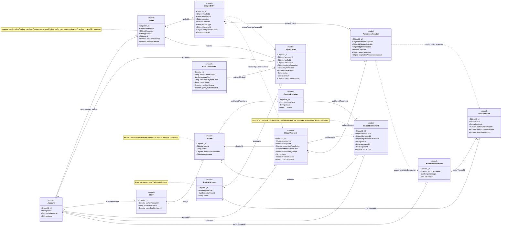

# Sơ đồ Coins và mua quyền đọc chương

Đối chiếu code NovelHub ngày 02/11/2026. Đây là class diagram các model nghiệp vụ (không phải sơ đồ controller/service). Chỉ chọn thuộc tính liên quan tới Coins; không liệt kê toàn bộ trường, audit reference hoặc timestamp. Không bao gồm Payouts.

## Class diagram — Coins



Quan hệ nét liền là tham chiếu ID; nét đứt biểu diễn phụ thuộc bằng snapshot hoặc sourceType/sourceId. Account–Wallet là quan hệ có điều kiện: chỉ ví ownerType=account mới có chủ sở hữu Account; ví hệ thống không thuộc admin. Không tạo class Platform giả vì code chỉ dùng system owner ID cố định. Bội số phản ánh tham chiếu schema: một request có thể chưa có entitlement/allocation; mua mới thành công tạo một entitlement và một allocation. Unique entitlement trên (accountId, chapterId). Một allocation ghi 2 hoặc 3 ledger trong luồng mua, tùy phần nhận có bằng 0; schema chỉ yêu cầu danh sách không rỗng. BankTransaction có thể đối chiếu cùng một order nhiều lần; chỉ giao dịch xác nhận được gắn vào TopUpOrder.bankTransactionId.

## Sequence diagram — Mua quyền đọc chương

```mermaid
sequenceDiagram
autonumber
actor Reader as Người đọc
participant UI as ChapterSegment / ChapterUnlock
participant API as Reader Unlock Router
participant Buy as Modules mua chương
participant Wallet as unlock-wallets
participant DB as MongoDB
participant Read as API đọc chương

Reader->>UI: Mở chương
UI->>Read: GET /catalog/stories/:storyId/chapters/:chapterId
Read->>DB: readableChapter(): kiểm tra quyền đọc
DB-->>Read: Chưa có quyền, còn thời gian đọc sớm
Read-->>UI: 403 chapter_locked
UI->>API: GET /reader/stories/:storyId/chapters/:chapterId/unlock-quote
API->>API: requireAuth + kiểm tra ID
API->>Buy: getReaderUnlockQuote(accountId, storyId, chapterId)
Buy->>DB: Đọc bản xuất bản, ví và quyền đọc
DB-->>Buy: Giá, số dư, trạng thái quyền
Buy-->>API: quote
API-->>UI: priceCoins, revisionId, balance, canAfford
alt Không đủ xu theo quote
  UI-->>Reader: Thông báo thiếu xu + nút đến ví
else Đủ xu theo quote
  UI-->>Reader: Hiện giá và nút Mở khóa
  Reader->>UI: Bấm Mở khóa
  UI->>API: POST .../unlock (expectedPriceCoins, expectedRevisionId, requestKey)
  API->>API: requireAuth + kiểm tra params/body
  Note over API,DB: Sai xác thực: 401; sai dữ liệu: 400. Không gọi nghiệp vụ mua.
  API->>Buy: purchaseReaderChapter(req, storyId, chapterId, input)
  Buy->>DB: ownerWrite(): BEGIN transaction, kiểm tra lại tài khoản
  Buy->>DB: lockUnlockTarget(): kiểm tra và cập nhật version truyện/tác giả/chương
  Buy->>DB: Tìm UnlockRequest theo operation + accountId + requestKey
  Buy->>DB: Kiểm tra thời hạn đọc sớm và UnlockEntitlement
  alt Đối tượng/quyền/yêu cầu cũ không hợp lệ
    Buy->>DB: ROLLBACK
    Buy-->>API: Lỗi 403 / 404 / 409 theo nguyên nhân
    API-->>UI: Phản hồi lỗi
    UI-->>Reader: Hiện lỗi; tải lại quote nếu 409
  else Chương đã miễn phí hoặc đã có quyền hợp lệ
    Buy->>DB: COMMIT, không ghi giao dịch tài chính mới
    Buy-->>API: state free / owned, reused true
    API-->>UI: 200
  else Chưa mua và chương còn trả phí
    Buy->>Buy: So sánh expectedPriceCoins và expectedRevisionId với dữ liệu hiện tại
    alt Giá hoặc bản xuất bản thay đổi
      Buy->>DB: ROLLBACK
      Buy-->>API: 409 unlock_quote_changed
      API-->>UI: 409
      UI->>API: Tải lại unlock-quote
    else Giá và bản xuất bản khớp
      Buy->>DB: Lấy PolicyVersion và AuthorRevenueRate có hiệu lực
      Buy->>Buy: getUnlockRevenueSplit(): tính phần tác giả và nền tảng
      Note over Buy,DB: Thiếu hoặc sai chính sách: báo lỗi và rollback.
      Buy->>DB: Tạo UnlockRequest, status requested
      Buy->>Wallet: transferUnlockCoins(..., session)
      Wallet->>DB: Trừ reader-coins nếu availableBalance >= priceCoins
      alt Không tìm được ví đủ xu
        Wallet-->>Buy: 409 insufficient_coins
        Buy->>DB: ROLLBACK toàn bộ transaction
        Buy-->>API: 409
        API-->>UI: 409
        UI->>API: Tải lại unlock-quote
      else Trừ reader thành công
        Wallet->>DB: Tìm/tạo author-earnings, cộng authorCoins
        Wallet->>DB: Tìm/tạo system-earnings, cộng platformCoins
        Wallet-->>Buy: Ba ví sau cập nhật
        Buy->>DB: Tạo UnlockEntitlement active, gắn publishedRevisionId
        Buy->>DB: Tạo LedgerEntry trừ reader và cộng bên nhận
        Buy->>DB: Tạo RevenueAllocation và snapshots
        Buy->>DB: Cập nhật UnlockRequest committed + entitlementId
        Buy->>DB: Tạo AuditEvent chapter.unlock.committed
        Note over Buy,DB: Lỗi ở bất kỳ bước ghi nào đều rollback cả ví, quyền và lịch sử.
        Buy->>DB: COMMIT transaction
        Buy-->>API: state owned, reused false, balance, entitlementId
        API-->>UI: 201 Created
      end
    end
  end
  opt Kết quả mua là owned hoặc free
    UI->>UI: onUnlocked() -> tăng attempt
    UI->>Read: Gọi lại GET nội dung chương
    Read->>DB: Kiểm tra lại quyền cho bản xuất bản hiện tại
    DB-->>Read: Được phép đọc
    Read-->>UI: Nội dung chương
    UI-->>Reader: Hiển thị chương
  end
end
```

Participant Modules mua chương gộp reader-unlocks.js, reading/owner-write.js, unlock-revenue.js và unlock-purchase.js để dễ đọc. MongoDB biểu diễn các model được truy cập. Mọi thao tác ghi trong luồng mua dùng chung session/transaction. Không gọi SePay khi mua chương; SePay thuộc luồng nạp xu. Tỷ lệ chia doanh thu lấy từ thỏa thuận tác giả có hiệu lực, nếu không có thì dùng chính sách chung. Request key chống xử lý lại cùng yêu cầu; entitlement chống thu lại khi gửi request key mới. Vòng retry tối đa 3 lần khi lỗi duplicate key và retry transaction của driver được lược khỏi sơ đồ.
