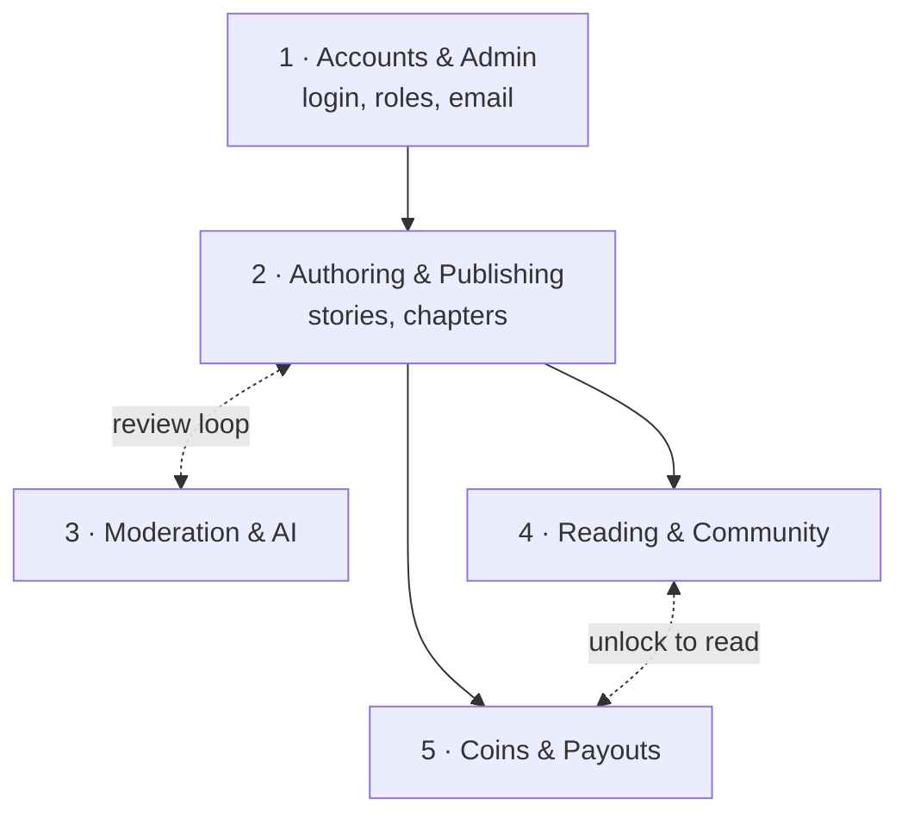

# NovelHub V1 — Team Work Plan

How the five of us split the remaining work, in what order, and what each
person depends on. Product rules live in
[`docs/decision-log.md`](docs/decision-log.md); the database design lives in
[Phase 3](plans/261007-1022-novelhub-requirements-to-database/phase-03-mongodb-logical-design.md).
This file only covers **who does what, and when**.

## Where we are

Merged into the current `main` baseline:

- Repo skeleton (npm workspaces, ESLint/Prettier, CI on GitHub Actions).
- Backend: Express API, MongoDB connection with transactions, health/readiness routes.
- All **47 Mongoose models** from the database design, with write guards and tests.
- Shared MongoDB on the group VPS ([connection details](../infra/mongo/README.md)).
- Minimal React app shell.

Authoring follow-up work:

- Author screens and shared reader/moderator surfaces are now present on `HuyNHHE190724`.
- Remaining follow-up is to replace any screen-specific mock data and finish external service configuration.

## The five fields

Each person owns one **field**: a business area, end to end — API, business
logic, tests, and wiring Huy's screens for that area to the real API. You only
edit files in your own field; other fields are used through their public
service functions (see [Rules](#rules-of-engagement)).

| #     | Field                     | Owner           | In short                                                                              |
| ----- | ------------------------- | --------------- | ------------------------------------------------------------------------------------- |
| **1** | Accounts & Administration | _TBD_           | Who you are and what you may do; Admin controls; email and notifications for everyone |
| **2** | Authoring & Publishing    | _TBD_           | Stories, chapters, editor, media, release                                             |
| **3** | Moderation & AI Review    | _TBD_           | Review queue, AI similarity evidence, decisions, reports                              |
| **4** | Reading & Community       | Huy (suggested) | Discovery, reader, guest preview, follows/ratings/comments, TTS, statistics           |
| **5** | Coins & Payouts           | _TBD_           | Top-up, unlocks, revenue split, monthly payouts                                       |

### Field 1 — Accounts & Administration

- Register, email verification (required before login), login, password reset,
  Google sign-in (links by matching email).
- Roles: every account is a Reader plus at most one of Author / Moderator /
  Admin. Author applications (apply, Admin approves/rejects).
- Suspend, remove Author role, delete (anonymize) account — and **orchestrate**
  what each other field must do when that happens.
- Admin: users, roles, categories, platform settings (price bounds, threshold,
  revenue default…).
- **Shared infrastructure for everyone:** email sending (retry up to 3 times),
  in-app notifications, audit log, effective policy lookup.
- Collections: `accounts`, `emailTokens`, `sessions`, `externalIdentities`,
  `roleAssignments`, `authorApplications`, `categories`, `policyVersions`,
  `auditEvents`, `notifications`, `notificationOutbox`, `deliveryAttempts`.
- Screens: `auth/JoinPage`, `admin/*`, `system/AccountPage`,
  `author/AuthorApplyPage`, `reader/NotificationsPage`.

### Field 2 — Authoring & Publishing

- Create/edit stories and chapters; block editor stored as a validated document
  (text + image blocks only); platform themes with 4 customization tokens.
- Image upload (object storage), text-layer PDF import (no OCR), rights
  declaration.
- Revisions: submitted revisions are frozen; editing a published chapter keeps
  the old version live until approved.
- Submit for review; release after approval (scheduled time, chapters released
  in order); early access turning free when it ends.
- Collections: `stories`, `chapters`, `contentRevisions`, `contentImports`,
  `rightsDeclarations`, `mediaAssets`.
- Screens: `author/CreateStoryPage`, `StoryManagerPage`, `DraftsPage`,
  `ChapterEditorPage`, `ImportPdfPage`, `MediaLibraryPage`,
  `SubmissionReviewPage`, `SubmittedPackagePage`, `AuthorPreviewPage`,
  `AuthorAnalyticsPage`, and `AuthorEarningsPage`.

### Field 3 — Moderation & AI Review

- Shared review queue: a Moderator claims an item; the claim expires after 24h.
- AI evidence pipeline: split chapter into passages → OpenAI embeddings →
  MongoDB vector search over NovelHub content (excluding the author's own) →
  LLM summary. Advisory only; failures fall back to manual review.
- Moderator decisions: approve / reject / request revision.
- Reader reports on stories, chapters, comments; resolutions (dismiss, hide
  comment, unpublish, warn author).
- Collections: `publicationSubmissions`, `evidenceBatches`,
  `processingAttempts`, `embeddingArtifacts`, `similarityFindings`,
  `llmReviews`, `moderationHistory`, `contentReports`, `reportResolutions`.
- Screens: `moderator/*`.

### Field 4 — Reading & Community

- Home, search, categories, rankings (popularity = unique daily views over 30
  days), story detail.
- Guests read chapter 1 only (locked preview if it is still in early access).
- Reader, reading progress and resume; **the access check** ("can this person
  read this chapter?").
- Follow, rate (1–5, one per story), comments (one-level replies, likes).
- TTS for logged-in readers (generated on first play, then cached).
- Statistics events and author analytics.
- Collections: `readingProgress`, `narrationAssets`, `comments`,
  `commentLikes`, `follows`, `ratings`, `statisticsEvents`, `authorStatistics`.
- Screens: `guest/*`, `reader/*` (except Wallet and Notifications),
  `author/AuthorAnalyticsPage`.
- Also: merge the frontend into `main` in M0 (see below).

### Field 5 — Coins & Payouts

- Top-up packages, payment page with VietQR, SePay webhook matching transfer
  code `NH` + 8 digits, exact amount only; mismatches go to an Admin review list.
- Wallets and append-only ledger; Admin adjustments with mandatory reason.
- Unlock early-access chapters; revenue split (per-author rate or 70/30
  default, author share rounded down).
- Monthly withdrawal job (1st, 00:00 Vietnam time, balance ≥ threshold),
  payout sheet, Admin marks rows Paid/Failed, payout slips.
- Collections: `wallets`, `ledgerEntries`, `topUpPackages`, `topUpOrders`,
  `bankTransactions`, `authorRevenueRates`, `unlockEntitlements`,
  `unlockRequests`, `revenueAllocations`, `withdrawalRequests`,
  `payoutSheetRows`, `payoutResultEntries`.
- Screens: `reader/WalletPage`, `author/AuthorEarningsPage`, and the Admin
  finance screens already tracked by the latest SRS/SDS.

## How the fields depend on each other

In one picture:

- **Field 1 is the base.** Everyone needs login, roles and email from it.
- **Field 2 is the content.** Moderation, reading and payments all work on
  stories and chapters.
- **Two pairs talk a lot:** 2 + 3 (submit → review → release) and 4 + 5
  (locked chapter → unlock → read). These pairs should work closely.

None of this means waiting: in M0 everyone publishes placeholder functions and
seed data, so all five fields can build in parallel from day one. The real
connections are switched on in M2.

The exact functions each field provides to the others:

| Contract                                                                                  | Provided by   | Used by                     | Needed in        |
| ----------------------------------------------------------------------------------------- | ------------- | --------------------------- | ---------------- |
| `req.account`, `requireRole()`, dev login, seed accounts                                  | 1             | everyone                    | M0               |
| `policy.getEffective()` (bounds, threshold, 70/30, expiries)                              | 1             | 2, 3, 5                     | M0               |
| `notify(event)` (logs only until M1 ends)                                                 | 1             | 2, 3, 4, 5                  | M0               |
| Account lifecycle hooks (`onAccountSuspended`, `onAuthorRoleRevoked`, `onAccountDeleted`) | 1 (runs them) | 2, 3, 4, 5 (implement them) | M3               |
| `publishing.getChapter()`, `publishing.applyDecision()`                                   | 2             | 3, 4, 5                     | M0 stub, M2 real |
| Storage adapter (local disk first)                                                        | 2             | 1, 4                        | M0               |
| Scheduled job runner                                                                      | 2             | 3, 5                        | M0               |
| `moderation.openSubmission()`, `reports.create()`                                         | 3             | 2, 4                        | M0 stub, M2 real |
| `access.canRead()`, `stats.record()`                                                      | 4             | 4, 5                        | M0 stub          |
| `ledger.post()`, `finance.hasActiveEntitlement()`                                         | 5             | 4                           | M0 stub, M2 real |

Two loops need care:

- **2 ↔ 3 (publish loop).** Field 2 owns every chapter status change and the
  release; field 3 owns submissions, evidence and decisions. Field 3 calls
  `applyDecision()` inside its decision transaction. This is the riskiest
  integration — do it first in M2.
- **4 ↔ 5 (reading access).** Field 4 owns the access check and asks field 5
  whether an unlock is active; field 5 reads chapter info from field 2.

## Phases

```mermaid
flowchart LR
  subgraph M0["M0 · Contracts & unblockers (2–3 days, all parallel)"]
    a0["1: auth middleware, seed, policy, notify stub"]
    b0["2: publishing API, storage adapter, job runner"]
    c0["3: submission/report API, fake AI adapters"]
    d0["4: frontend merged to main, canRead/stats API"]
    e0["5: ledger, wallets, entitlement API, webhook test URL"]
  end
  subgraph M1["M1 · Each field end-to-end on seed data (~2 weeks, parallel)"]
    a1[1 auth + admin + real email]
    b1[2 authoring + release]
    c1[3 queue + AI + decisions]
    d1[4 discovery + reader + community]
    e1[5 top-up + unlock + wallet]
  end
  subgraph M2["M2 · Real calls instead of stubs (~1 week, in pairs)"]
    p23["2+3 submit → review → release"]
    p45["4+5 locked → unlock → read"]
    p1["1 + all: real emails & notices"]
    p432["4+3+2 report → resolve → unpublish"]
  end
  subgraph M3["M3 · Jobs & cross-field processes (~1 week, parallel)"]
    a3[1 suspend / revoke / delete]
    b3[2 release cascade, early access → free]
    c3[3 claim expiry]
    d3[4 TTS, popularity, author stats]
    e3[5 monthly payout + payout sheet]
  end
  M0 --> M1 --> M2 --> M3 --> M4["M4 · E2E tests, deploy, demo data"]
```

Durations are estimates; we'll scale them to the deadline.

### M0 — Contracts & unblockers (gate for everything)

Everyone works in parallel. Each person ships their field's **public service
file** (`backend/src/modules/<field>/service.js`): every function the other
fields will call, documented, returning placeholder data for now — plus the
real pieces others need:

| Field | Delivers                                                                                                                                                                                                           |
| ----- | ------------------------------------------------------------------------------------------------------------------------------------------------------------------------------------------------------------------ |
| 1     | Auth middleware (`req.account`, `requireRole`), dev login with seed accounts (one per role), `policy.getEffective()`, `notify()` that logs, lifecycle hook registry                                                |
| 2     | `getChapter` / `applyDecision` stubs, storage adapter (local disk), scheduled job runner, seed content in **every** chapter state                                                                                  |
| 3     | `openSubmission` / `reports.create` stubs, fake embedding and LLM adapters                                                                                                                                         |
| 4     | Huy's frontend merged into `main` (backend skeleton from that branch dropped, API client pointed at `/api`, AI writing assistant page removed — not in V1), route guards by role, `canRead` / `stats.record` stubs |
| 5     | `ledger.post` inside a transaction, wallet created on sign-up, `hasActiveEntitlement` stub, a public test URL for the SePay webhook (Cloudflare tunnel or VPS)                                                     |

Also agree as a team: error format, pagination, folder layout.

**Done when:** `npm test` passes, the seed script creates one account per role
and content in every state, every field has its service file, and the frontend
on `main` still renders.

### M1 — Each field end-to-end on seed data

Fully parallel; nobody waits on anyone. Use seed data and the other fields'
stubs. **Done when** each field's screens work against the real API with seed
data and its main flows have tests.

### M2 — Integration in pairs

Replace stubs with real calls, one pair at a time:

1. **2 + 3:** author submits → AI evidence → moderator decides → chapter released.
2. **4 + 5:** reader hits a locked chapter → tops up → unlocks → reads.
3. **1 + everyone:** real emails and in-app notifications.
4. **4 + 3 + 2:** reader reports → moderator resolves → content unpublished.

**Done when** the main demo flow works: an author publishes, a moderator
reviews, a reader tops up, unlocks and reads.

### M3 — Scheduled jobs and cross-field processes

Independent of each other, so parallel again:

- Field 1: suspend / remove Author role / delete account across all fields.
- Field 2: release cascade (late approval waits for the previous chapter),
  early access becoming free.
- Field 3: claim expiry.
- Field 4: TTS, 30-day popularity, author statistics.
- Field 5: monthly payout job, payout sheet, slips, final payout on deletion.

### M4 — Hardening

End-to-end tests for the main flows, Docker deployment on the VPS, a real
SePay test on the deployed URL, demo data, final review.

## External setup — start on day 1

These take time and will block people mid-phase if left late.

| Item                                                | Field | Note                                                |
| --------------------------------------------------- | ----- | --------------------------------------------------- |
| SePay account + bank + **public HTTPS webhook URL** | 5     | Webhooks can't reach `localhost`                    |
| VietQR API access                                   | 5     |                                                     |
| Google OAuth client + redirect URLs                 | 1     | Needs a fixed public URL too                        |
| Gmail SMTP app password                             | 1     | Until then, print verification links to the console |
| OpenAI API key                                      | 3     | Build with fake adapters first                      |
| Object storage (VPSTTT) credentials                 | 2     | Local-disk adapter until then                       |
| **TTS provider decision**                           | 4     | Still undecided — must be chosen before M3          |

## Rules of engagement

- **Stay in your field.** Code lives in `backend/src/modules/<field>/` and the
  matching frontend pages. Don't import another field's models — call its
  `service.js`.
- **Changing a contract** (a function another field calls) needs a heads-up in
  the group chat and a PR the consumer approves.
- **Anything that writes more than one document** (unlock, top-up, payout,
  moderation decision) runs inside `withTransaction`.
- **Business rules come from [`docs/decision-log.md`](docs/decision-log.md).**
  If something isn't there, ask the team instead of guessing.
- Work on a branch per task, open a PR to `main`, CI must be green, one
  teammate reviews.
- Setup: see the [root README](../README.md).

## Risks

| Risk                                                 | Mitigation                                                             |
| ---------------------------------------------------- | ---------------------------------------------------------------------- |
| Field 1 blocks everyone in M0                        | Keep M0 minimal (dev login); real login can wait until M1              |
| Contracts change silently during M1 → breakage in M2 | Contract changes go through a PR the consumer approves                 |
| Publish loop (2 ↔ 3) is complex                      | Integrate it first in M2                                               |
| Money must be exactly right (field 5)                | Ledger is append-only; every flow has tests for duplicates and retries |
| Field 5 has screens that don't exist yet             | Lighter backend scope; start UI early                                  |
| TTS provider undecided                               | Decide before M3                                                       |

## Still to decide

1. **Deadline** — phase durations will be scaled to it.
2. **Who owns fields 1, 2, 3, 5** (Huy suggested for 4), and whether the team
   lead also reviews/integrates.
3. **TTS provider**, and who decides by when.

## Latest documentation alignment

The latest SRS and SDS supplied for this project are the source for the Author use cases. The repository traceability is in [`docs/authoring-publishing.md`](docs/authoring-publishing.md). The AI writing assistant prototype is retained as historical code but is outside the current Author screen flow; `/author/ai` returns to the Author dashboard. The finance UI now reads the Author earnings wallet, append-only ledger and payout history from `/api/author/earnings`.
