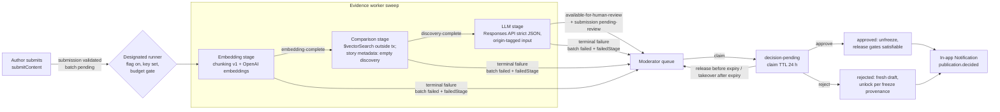

# Moderator approval process and AI evidence pipeline

## Overview

When this plan is done, every submitted story or chapter gets AI evidence from a background worker (OpenAI embeddings, MongoDB `$vectorSearch` similarity, OpenAI LLM synthesis), lands in a moderator queue, and is claimed, reviewed and approved or rejected through a real API and UI. Approval leaves the existing release gates satisfiable; rejection unlocks the author immediately with a fresh draft. The author gets an in-app notification. The worker runs in one designated process, under a persisted 3 USD budget. Today nothing moves a submission past `validated` (`backend/src/modules/author-submissions.js:336-364`) and the moderator pages run on mock data.

## Scope and non-goals

In scope: review lifecycle and moderator decision API, AI evidence worker with budget guard, operator scripts (vector index, plan-based backfill, rollback), moderator frontend on the real API, and a live rollout with one real end-to-end smoke and documentation.

Non-goals: content reports (UC-MOD-04/05), similarity escalation, AI auto-decisions, moderator role administration, a CI job with mongot, and rewriting existing test fixtures that set approval state directly. <!-- Updated: Validation Session 1 - e-mail removed --> Decision e-mail is deferred by user decision on 2026-10-29; the in-app notification ships now.

## Architecture

<!-- Updated: Validation Session 1 - outbox and e-mail nodes removed -->

## Phases

<!-- Updated: Validation Session 1 - e-mail phase removed; rollout renumbered to 04 -->
| # | Phase | Depends on | Effort | Status |
|---|-------|-----------|--------|--------|
| 01 | [Review lifecycle and moderator decision API](./phase-01-review-lifecycle-and-decision-api.md) | none | 13h | Completed |
| 02 | [AI evidence pipeline](./phase-02-ai-evidence-pipeline.md) | 01 | 20h | Completed |
| 03 | [Moderator frontend on the real API](./phase-03-moderator-frontend-real-api.md) | 01, 02 | 11h | Completed |
| 04 | [Shared-environment rollout, live smoke and documentation](./phase-04-shared-environment-rollout-smoke-docs.md) | 01, 02, 03 | 6h | Completed |

## Key decisions

All product decisions come from [the design decisions report](./reports/design-decisions.md) and the user's answers in the Validation Log. Evidence: [backend scout](./reports/scout-backend-moderation.md), [AI and frontend scout](./reports/scout-ai-frontend.md), [OpenAI research](./research/researcher-01-openai.md), [vector search research](./research/researcher-02-vector-search.md), [red-team findings](./reports/red-team-findings.md).

Implementation details added by the plan (not product rules):
- Moderator code lives in `backend/src/modules/moderation/`, AI code in `backend/src/modules/ai/`. The moderator package view reuses `loadSubmittedPackage`/`submittedImage` and the decision reuses `lockAuthor`; no existing helper is refactored or re-exported.
- `LlmReview` gains `summary`, `riskLevel`, `reviewedChars`, `totalChars`; `EmbeddingArtifact` gains `source` and `costUsd`; `ModerationHistory` gains index `{ action: 1, occurredAt: -1 }`.
- `approvedReviewEvidence` is deleted; both release gates call `terminalEvidenceReady`. `npm run ai:fail-pending` is the rollback that keeps submissions out of `validated`.
- `AI_EVIDENCE_WORKER_ENABLED` (default `false`) and `AI_BUDGET_USD` (default `3`) gate every provider call; every attempt records `costUsd` and `runner`.

## Dependencies

- Phase 02 adds the `openai` npm dependency pinned to `7.45.1` (Node ≥ 22 matches `package.json:9-11`).
- Phase 04 needs `backend/.env` with `MONGODB_URI` and `OPENAI_API_KEY`, the shared VPS mongot (`infra/mongo/README.md:3-7`), network access and two user confirmations (hard limit, single runner).
- Phases share files (`backend/src/server.js`, `backend/src/config/env.js`, `backend/.env.example`, `backend/package.json`). Phases therefore run strictly in order.

## Risks

| Risk | Likelihood × impact | Mitigation |
|---|---|---|
| Teammates' backends on the shared database run the worker | High × High | Flag off by default; one designated runner; foreign-lease check in the preflight. |
| OpenAI spend exceeds 3 USD | Medium × High | Persisted cost ledger, worst-case budget gate, plan-based backfill cap, preflight check, OpenAI hard limit. |
| Decision transaction leaves release gates unsatisfiable | Medium × High | Phase 01 tests release the approved story through the real author release endpoint. |
| Missing or building vector index silently returns no matches | Medium × High | `READY` and `queryable` required; the smoke requires a real match against a passage it published. |
| Rolling back strands submissions in `validated` | Medium × High | `npm run ai:fail-pending` fails pending evidence to manual review before code is reverted. |

## Executor rules

<!-- Red Team: groups 1, 3, 15 --> <!-- Updated: Validation Session 1 - four phases; no e-mail steps -->
1. Work the phases in order: 01, 02, 03, 04. Do not start a phase before the previous phase's regression gate passes.
2. Each phase file's Failure Protocol is binding. A failed Verify step stops the phase.
3. Never call OpenAI in tests. Tests inject provider doubles through `config.ai` or the SDK `fetch` option.
4. Never write to the shared database (the one in `backend/.env`) except in the Phase 04 tasks marked **writes to the shared database** (Tasks 4.5, 4.6, 4.8, 4.9, 4.10). Tests use the in-memory replica set only. Never run `npm run db:sync-indexes` against the shared database.
5. The evidence worker is off by default: every `backend/.env` keeps `AI_EVIDENCE_WORKER_ENABLED=false`. Only the designated runner of Phase 04 Task 4.9 enables it, for its own process, with a shell variable, after the user has confirmed that no other runner exists.
6. Total OpenAI budget is 3 USD across backfill, queued submissions and the smoke; `AI_BUDGET_USD=3` enforces it and the user confirms the OpenAI project hard limit in Phase 04 Task 4.3.
7. Never print values from `backend/.env`. Print only whether a key is set and its source.

## Open questions

None. Q1-Q4 were answered in Validation Session 1 (see the Validation Log).

## Red Team Review

### Session 2026-10-29

Source: [red-team findings](./reports/red-team-findings.md). 34 raw findings deduplicated into 16 groups: 15 accepted (10 High, 5 Medium), 1 rejected. Group 9 became not applicable after Validation Session 1 removed the e-mail outbox.

| # | Group | Severity | Disposition | Applied in |
|---|---|---|---|---|
| 1 | Workers run in every teammate backend on the shared DB | High | Accept | P02 Tasks 2.2, 2.9, 2.10, 2.16; P04 Tasks 4.2, 4.3, 4.9; executor rules |
| 2 | Rollback strands submissions in `validated` after the bypass is removed | High | Accept | P02 Task 2.13 and rollback; P04 rollback |
| 3 | No hard OpenAI budget boundary; preflight under-estimates | High | Accept | P02 Tasks 2.2, 2.4, 2.9, 2.10, 2.14; P04 Tasks 4.2, 4.3 |
| 4 | LLM stage sends stale/ineligible sources; stale claims still call providers | High | Accept | P02 Tasks 2.10, 2.12; P01 Task 1.7 |
| 5 | Long chapters: embedding request over 300k tokens; silent LLM truncation | High | Accept | P01 Task 1.7; P02 Tasks 2.3, 2.4, 2.10; P03 Tasks 3.1, 3.5 |
| 6 | Prompt injection through submitter text, licence note and other authors' passages | Medium | Accept | P02 Tasks 2.8, 2.12; P03 Tasks 3.1, 3.5 |
| 7 | `openai` dependency floating; SDK reads `OPENAI_BASE_URL`/org/project from shell | Medium | Accept | P02 Tasks 2.1, 2.2, 2.5, 2.6 |
| 8 | Suspended authors are processed and queued but can never be decided | Medium | Accept | P01 Tasks 1.6, 1.7, 1.12; P02 Tasks 2.10, 2.12 |
| 9 | Outbox lease shorter than SMTP time; duplicate mail; console sender logs address; smoke recipient | High | Accept, then not applicable | E-mail outbox removed in Validation Session 1; the smoke uses reserved `.invalid` addresses and sends no e-mail |
| 10 | Smoke script self-grants unaudited permanent roles; weak account reuse check | Medium | Accept | P04 Task 4.2 |
| 11 | Expired claim release by former owner; decision error codes inconsistent; duplicate package/lock helpers | High | Accept | P01 Tasks 1.2, 1.3, 1.6, 1.7, 1.8, 1.12, 1.13 |
| 12 | Backfill omits submission-less chapters, re-selects the same window, keeps partial inserts, aborts on one error | High | Accept | P02 Tasks 2.3, 2.14; P04 Tasks 4.7, 4.8 |
| 13 | Live smoke can pass without `$vectorSearch`; backlog makes it time out | High | Accept | P04 Tasks 4.2, 4.10 |
| 14 | Transient vector errors, score > 1, sweep abort, detail counts, test mechanics, i18n Verify | High | Accept | P01 Tasks 1.7, 1.12, 1.13; P02 Tasks 2.7, 2.10, 2.11, 2.12; P03 Tasks 3.1, 3.5, 3.7 |
| 15 | `db:sync-indexes` can drop teammates' indexes on the shared DB | Medium | Accept | P04 Tasks 4.1, 4.4, 4.5; executor rules |
| R1 | Move Phase 04 right after Phase 01 | — | Reject | Sequential order is safe; the former Phase 04 no longer exists |

## Validation Log

### Session 1 — 2026-10-29

| Question | Answer | Propagated changes |
|---|---|---|
| Q1 Story-metadata submissions in the AI pipeline | Run the pipeline: embed title and synopsis, record comparison as a successful empty discovery, run the LLM on the metadata | Settled; matches P02 Tasks 2.4 and 2.10 and test 2.11.4; removed from open questions |
| Q2 E-mail outbox now or in-app only | In-app notification only | Former Phase 04 (decision e-mail) deleted; rollout renumbered to Phase 04 with dependencies 01-03; no outbox row, outbox worker, outbox flag, SMTP preflight or e-mail smoke check remains; red-team group 9 not applicable; scope note added |
| Q3 Default review model | `gpt-6-luna` with reasoning effort `low` | Settled; matches P02 Task 2.2 defaults |
| Q4 Claim TTL | 24 hours via `MODERATION_CLAIM_HOURS` | Settled; matches P01 Task 1.1 |

### Whole-Plan Consistency Sweep

Covers both sessions; re-read `plan.md` and all four phase files (14 + 16 + 8 + 13 = 51 tasks, each with Goal, Target, Steps, Success criteria and Verify; the Failure Protocol block is byte-identical in all four phases).

- Red-team stale terms, 0 stale hits: `0.006`, `example.com`, `verifySubmittedPackage`, a `lockAccount` export, `noSubmission`, `passage-limit`, `persist-conflict`, `^7.45.1`, an unconditional `startEvidenceWorker` call (the single call site is behind `config.ai.workerEnabled`), and `submission_changed` for unclaimed decisions or releases (now `claim_required`). `db:sync-indexes` has 8 hits, all explanations or prohibitions; no task runs it.
- Validation terms (`outbox`, `e-mail`, `email`, `SMTP`, `NOTIFICATION_OUTBOX`, `phase-05`, `Phase 05`, `phase-04-decision`, `Task 5.`, `DeliveryAttempt`): 13 hits, all deferral notes, change markers or the `Account.email` field; 0 stale.
- Reconciled: (1) groups 4 and 8 overlap when an author becomes inactive between selection and claim; the worker skips without writing so the submission resumes after reinstatement, and only a closed submission gets `submission-closed`. (2) Group 9 and the outbox parts of groups 1 and 14 are not applicable after Q2. (3) Guard-test fixtures use request-group sizes derived from the 200k-token limit and the 1,024 KB JSON limit. (4) The documented failure-code list and the twelve section-11 keys match Phase 02. (5) Dependencies, task numbers and links use the four-phase numbering.
- Markers: 63 `Red Team` markers and 9 `Updated: Validation Session 1` markers. Unresolved contradictions: none. `reports/design-decisions.md` still describes the e-mail outbox as input history; the Validation Log supersedes it.
